<p align="center">
  
</p>

<p align="center">
  <strong>Verifiable Financial Audit Infrastructure</strong>
</p>

# Pramaan (प्रमाण)

**AI that doesn't just find financial discrepancies: it investigates, proves and explains them.** Every finding opens with *How we know* (the rule, the calculation with real numbers, the fingerprinted source files, and what is still needed) and a *Proof chain* that follows the sale through books, register, GSTR-1, price, dispatch, transport, e-invoice, credit notes and bank. Both are computed by the rule engine from the frozen run; the AI investigates and drafts, a human decides.

Pramaan is a local, synthetic-data prototype for statutory revenue-audit work. It preserves a client-provided sales register, reconciles it with recorded sales, runs deterministic checks against an immutable snapshot, and produces reviewable workpapers.

An invoice can show a sale was recorded; it does not itself establish that the sale occurred. Pramaan preserves the original source, evidence and rules behind each observation, sampling provenance, later changes, and a separately authorized human conclusion.

> Scope: a single-company SQLite prototype using fictional synthetic data. It is not a production deployment, audit opinion, official GST/IRP verification, or fraud determination.

**New here?** Read **[Getting started](docs/GETTING_STARTED.md)**, or the **[complete walkthrough PDF](docs/PRAMAAN_Walkthrough.pdf)** (33 pages, for both non-technical readers and engineers): install, double-click the launcher, sign in, and take a tour with screenshots. Every screen also has a **Help** button and plain-language hints on audit terms.

<p align="center">
  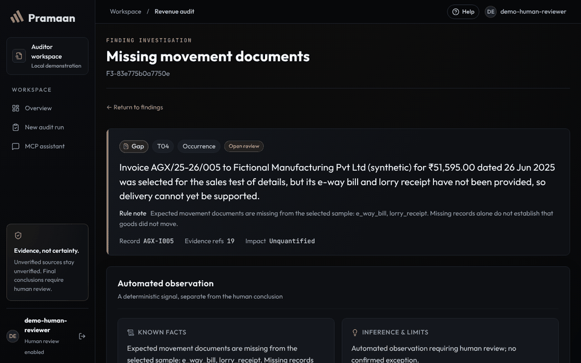
  <br><sub>The investigation agent on a planted register difference (shown here with the no-AI planner; the Gemini planner follows the same steps and guardrails).</sub>
</p>

## Quick start

Prerequisites: Python 3.11+ (tested on 3.11.9 and 3.13.14), Node 20.19+ or 22.12+ (tested on Node 20.20.2), and npm. Run from this repository directory.

```powershell
py -m venv .venv-p4
.\.venv-p4\Scripts\python.exe -m pip install -r backend/requirements-dev.txt
$env:PYTHONPATH = Join-Path $PWD.Path 'launcher'
.\.venv-p4\Scripts\python.exe -m Pramaan.backend.demo reset
Push-Location web
npm ci
Pop-Location
```

**After pulling changes**, run `npm ci` in `web/` again whenever `web/package-lock.json` changed. Otherwise Vite fails with errors like `Failed to resolve import "@fontsource/..."`. `START_PRAMAAN.bat` and `run-local.sh` detect a changed lock file and reinstall automatically. If `npm ci` reports locked files on Windows, close VS Code and any running Vite window, delete `web\node_modules`, and retry.

Start the API:

```powershell
$env:PYTHONPATH = Join-Path $PWD.Path 'launcher'
$env:PRAMAAN_DATA = Join-Path $PWD.Path '.demo/runtime'
.\.venv-p4\Scripts\python.exe -m uvicorn Pramaan.backend.app:app --host 127.0.0.1 --port 8000 --no-access-log
```

Then start the web application in another terminal:

```powershell
Set-Location web
npm run dev
```

Open [http://127.0.0.1:5173](http://127.0.0.1:5173), then issue only the credential needed for the active session:

```powershell
$env:PYTHONPATH = Join-Path $PWD.Path 'launcher'
.\.venv-p4\Scripts\python.exe -m Pramaan.backend.demo credentials --identity client
.\.venv-p4\Scripts\python.exe -m Pramaan.backend.demo credentials --identity auditor
.\.venv-p4\Scripts\python.exe -m Pramaan.backend.demo credentials --identity human
```

reset reloads only .demo/runtime; it does not change source fixtures or backend/data. It creates synthetic business data, revocable credentials, preserved sources, reconciliation data, and a sample audit run. Do not reset an instance whose work must be retained.

> **Important — Python package import.** Backend modules import themselves as `from Pramaan.backend import ...`. Set `PYTHONPATH` to the absolute path of the tracked `launcher/` folder; its shim maps `Pramaan` to the repository root for any checkout folder name, on every OS. `START_PRAMAAN.bat`, `start-local.ps1`, `run-local.sh`, Playwright and CI all do this.

### Choose what's in the workspace

The first launch creates a small synthetic demo. To start from something else (Windows PowerShell, from the project folder):

```powershell
.\START_PRAMAAN.bat clean             # empty workspace: add your own company and files
.\START_PRAMAAN.bat company honest    # Kesar Home Decor: a full year whose records agree
.\START_PRAMAAN.bat company hiding    # Neelgiri Lifestyle: a full year hiding 12 problems
.\START_PRAMAAN.bat demo              # back to the original small demo
```

Each option replaces `.demo\runtime` and asks first. The two sample companies are fictional Indian businesses built from real trading patterns (UCI Online Retail II, CC BY 4.0); see [docs/sample-companies](docs/sample-companies/README.md) and, after trying, the [answer key](docs/sample-companies/ANSWER_KEY.md).

## Demonstration

Screenshots of every screen at six widths (360–1920 px), before and after the UI/UX audit, are in [docs/ui-audit/screenshots](docs/ui-audit/screenshots); the audit report is [docs/UI_UX_AUDIT.md](docs/UI_UX_AUDIT.md). No video is tracked. The repeatable browser walkthrough is [web/e2e/workflow.spec.mjs](web/e2e/workflow.spec.mjs); accurate narrated steps are in [docs/DEMO.md](docs/DEMO.md).

1. A client creates business records and preserves an original register upload.
2. An auditor reconciles the register and opens an immutable audit run.
3. The auditor investigates samples, findings, evidence requests, and integrity status.
4. A client submits company-supplied evidence; a rerun creates a new snapshot rather than changing history.
5. An auditor stores a proposal; a separately provisioned human reviewer appends the final decision and creates frozen exports.
6. A later source revision is preserved as a new upload and appears as a post-test change without rewriting earlier packages.

## Contents

- [Getting started (non-technical, with screenshots)](docs/GETTING_STARTED.md)
- [What is built](#what-is-built)
- [System architecture](#system-architecture)
- [End-to-end workflow](#end-to-end-workflow)
- [Importing Tally exports and PDFs](#importing-tally-exports-and-pdfs)
- [Audit engine and detection rules](#audit-engine-and-detection-rules)
- [Evidence integrity and cryptography](#evidence-integrity-and-cryptography)
- [Authentication authorization and safeguards](#authentication-authorization-and-safeguards)
- [MCP architecture and tools](#mcp-architecture-and-tools)
- [AI/LLM integration](#aillm-integration)
- [Investigation agent](#investigation-agent)
- [Outputs and user interface](#outputs-and-user-interface)
- [Installation configuration and tests](#installation-configuration-and-tests)
- [Measured results and limitations](#measured-results-and-limitations)
- [Repository map](#repository-map)
- [Security, contributing and changes](#security-contributing-and-changes)
- [License](#license)

## What is built

| Area              | Actual implementation                                                                                                                                                                                                       |
| ----------------- | --------------------------------------------------------------------------------------------------------------------------------------------------------------------------------------------------------------------------- |
| Business records  | Client employees create customers and atomic sale lifecycles: order, dispatch, invoice, a balanced receivable/revenue/tax journal, plus optional receipt, credit note, and invoice evidence. Corrections append a reversal. |
| Preserved sources | CSV registers and related-party disclosures are stored by SHA-256-addressed content. Parsed comparison metadata is kept separately from original bytes.                                                                     |
| Audit runs        | Auditor-created immutable snapshots retain period, source state, rule/sampler versions, sampling seed, and snapshot hash. Reruns are new runs.                                                                              |
| Audit work        | Reconciliation, related-party leads, deterministic tests, reproducible sampling, evidence requests, post-test-change mapping, and audit-log verification.                                                                   |
| Review            | An auditor can propose a decision. A separately provisioned human-review credential appends the final decision and any supported impact assertion.                                                                          |
| Exports           | Frozen XLSX workpapers, PDF memo, and defensibility ZIP bind the stored snapshot, sources, reviews, rules, and integrity data.                                                                                              |
| Interfaces        | React/Vite client and auditor workspaces plus an official MCP SDK adapter over the implemented backend.                                                                                                                     |

## System architecture

<p align="center">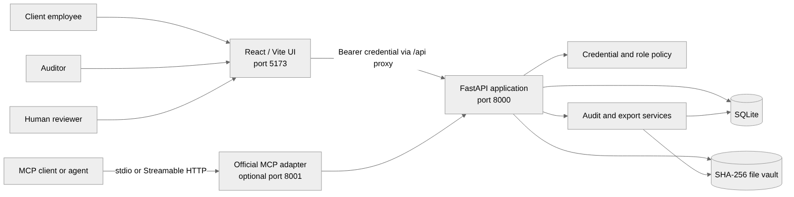</p>

<details><summary>Diagram source (Mermaid)</summary>

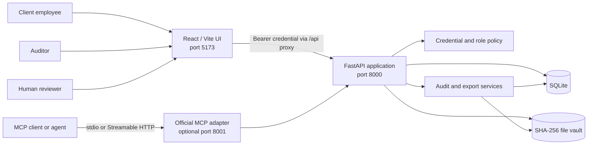

</details>

| Component             | Location                                                                                       | Responsibility                                                                                                       |
| --------------------- | ---------------------------------------------------------------------------------------------- | -------------------------------------------------------------------------------------------------------------------- |
| Web application       | [web](web/)                                                                                    | Client records, preserved sources, audit runs, findings, workpapers, and integrity views. No direct database access. |
| API/policy boundary   | [backend/app.py](backend/app.py)                                                               | Authenticated FastAPI routes, policy checks, domain orchestration, and UI read models.                               |
| Domain/audit services | [backend/p2.py](backend/p2.py), [backend/p3.py](backend/p3.py), [backend/p5.py](backend/p5.py) | Lifecycle/reconciliation, snapshot tests and sampling, then review/package generation.                               |
| Security/trail        | [backend/security.py](backend/security.py), [backend/p4.py](backend/p4.py)                     | Hashed credential storage, expiry/revocation, constrained SQLite connections, and local audit events.                |
| MCP adapter           | [backend/mcp_server.py](backend/mcp_server.py)                                                 | Official SDK adapter with no direct DB/domain imports; it delegates each tool call to FastAPI.                       |
| Content vault         | selected data root                                                                             | SHA-256-addressed bytes for source files and evidence.                                                               |

| Design rule            | Meaning                                                                                                                |
| ---------------------- | ---------------------------------------------------------------------------------------------------------------------- |
| Preserve originals     | A revised register is a new upload, never an overwrite.                                                                |
| Deterministic core     | Audit observations, snapshots, reconciliation, and sampling do not depend on an LLM.                                   |
| Separate authorities   | Client writes, auditor investigation, auditor proposals, and final review are separate operations.                     |
| Frozen outputs         | Packages are created from stored snapshot/review data; live changes require a new package.                             |
| Honest integrity claim | Hashes establish content identity and local-chain tampering signals, not source authenticity or file-owner resistance. |

## End-to-end workflow

<p align="center">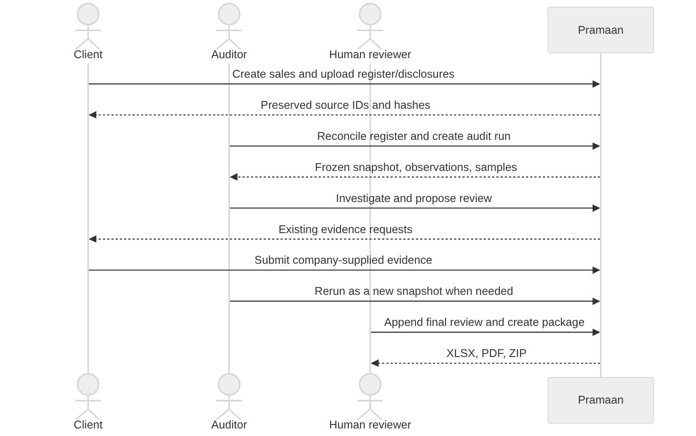</p>

<details><summary>Diagram source (Mermaid)</summary>

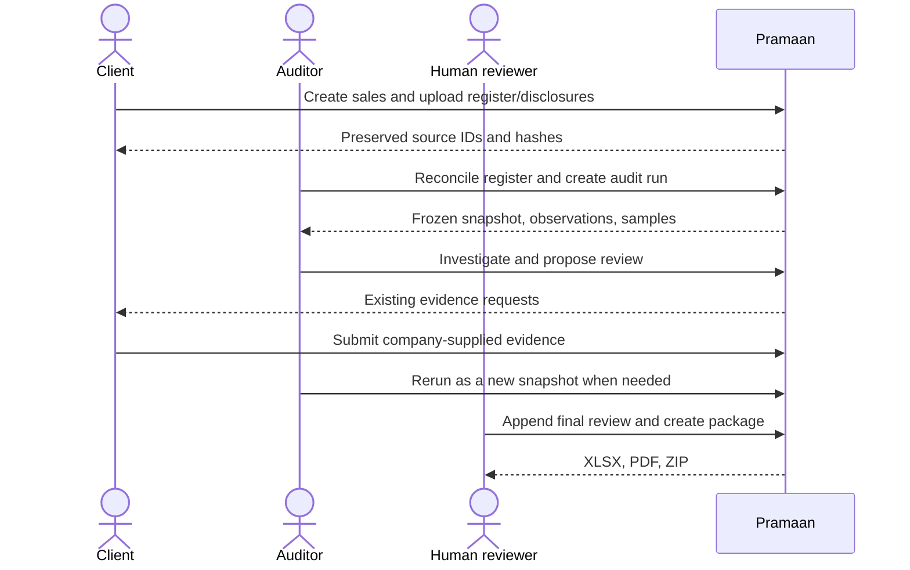

</details>

| Step              | Persisted result                                                               | Boundary                                                                          |
| ----------------- | ------------------------------------------------------------------------------ | --------------------------------------------------------------------------------- |
| Preserve register | Original CSV bytes, source hash, parsed rows, import metadata                  | Comparison metadata cannot alter source bytes.                                    |
| Reconcile         | T00 register-only/system-only, field-difference, and parse-review observations | Invalid/missing comparison input is a review gap, not an established discrepancy. |
| Create run        | Snapshot, hash, period, seed, versions, coverage, findings, samples            | A rerun is a new immutable run.                                                   |
| Evidence          | Persisted requests and company-supplied evidence references                    | The request-listing tool exposes requests; it does not send external messages.    |
| Review/package    | Revisioned proposal/final decision and stored exports                          | Existing packages remain frozen after live changes.                               |

## Importing Tally exports and PDFs

Clients rarely have clean CSVs, so PRAMAAN reads three common real-world formats. Every reader is deterministic: it reports what it could not read instead of guessing, the original file is always the preserved source (SHA-256 in the vault), and every reading is company-supplied, never independent verification. Code: [backend/document_import.py](backend/document_import.py).

| Input | Where | What happens |
|---|---|---|
| **Tally XML export** (TallyPrime / Tally.ERP 9: *Export → Day Book* or sales vouchers, XML format; UTF-8 or UTF-16) | Client → Registers & disclosures → *Sales register (Tally XML export)*, or `POST /p2/registers` with `"source_format": "tally_xml"` | Sales vouchers become register rows (`Bill No`, `Date`, `Customer`, `Gross Amt` from the party ledger amount, `GST No`). The import report counts **imported**, **skipped** (receipts, orders, returns, cancelled or optional vouchers), **rejected** (a sales voucher with an unreadable date, missing number/party, or an unreadable amount) and **warnings** (GSTIN with a wrong check digit, repeated voucher number, ledger entries that don't balance, customer ledger credited instead of debited). Warnings are shown, never auto-corrected. The XML file itself is the preserved register, so reconciliation (T00) and every later step work unchanged. A DOCTYPE or entity declaration anywhere in the file is refused. |
| **Bank statement PDF** (from net banking; text PDF, or a scan when OCR is installed) | Client → *Bank statement (CSV or PDF)*, or `POST /p6/bank-statements` with the PDF | Two layouts are recognised from the header row: separate **Debit/Credit** columns, or one **Amount** column with a **Dr/Cr** column or suffix, a minus sign, or a running Balance. Any column order works. Each row records how its direction was decided (`direction_source`). A row nothing settles, or a negative amount marked Cr, is listed as `unread`; a layout with no way to tell debits from credits is refused. Also handled: value dates, narration wrapped onto a second line, overdrawn (Dr) balances, multi-page statements. Each stored row keeps its page and line (`p6_bank_row_sources`). |
| **Bank statement checks** (PDF and CSV) | Same upload | The **running balance** is recomputed and every printed balance that doesn't add up is listed. Each statement's **opening balance is compared with the previous statement's closing balance**; a gap shows the unexplained difference (missing transactions). **The same file twice is refused** (HTTP 409, also under simultaneous uploads). Transactions that also appear in another statement are reported and counted once by the investigation agent. The CSV reader accepts common bank headers (*Dr/Cr*, *Particulars*, *Txn Date*, *Closing Balance*). |
| **Invoice PDF** (uploaded as an *Invoice copy* in the evidence inbox) | Read automatically when it arrives | Invoice number, date, GSTINs, taxable value, CGST/SGST/IGST, round-off and total are read, with the page each came from, and stored once (`p3_document_reads`, append-only). **GST arithmetic** is checked, and IGST charged together with CGST/SGST is flagged. A label printing two different values is marked **ambiguous**, not picked. Duplicate invoices across sales are flagged. The total is also compared with the **sales-register row** for that bill. Auditors see a field-by-field table with a **Quality** state for every field: *exact*, *validated*, *OCR*, *ambiguous*, *unreadable* or *human-verified*. These are fixed rules, not confidence percentages. A reader failure never loses the uploaded file. |
| **Scanned PDFs (OCR)** | Same uploads, if [Tesseract](https://github.com/tesseract-ocr/tesseract) is installed on the server machine | Image-only pages are read by local OCR (`backend/ocr.py`). Nothing leaves the machine, and there are limits of 20 pages, 30 s per page and 120 s per document. Words OCR is unsure of are never imported automatically, and every OCR value is marked *OCR* and needs a human reviewer's confirmation before it counts as a match. Without Tesseract, scans are refused with instructions. |
| **Replacing a wrong document** | Evidence inbox → *Uploaded the wrong file? Replace it*, or `POST /p3/evidence/{id}/replace` | The corrected file becomes a new version with a reason. The original file, row and SHA-256 stay unchanged (`p3_evidence_versions`, append-only), and the replacement is logged. Audit runs frozen before the replacement keep the old file and reproduce exactly; the next run uses the corrected one. |
| **Human field verification** | Auditor → run → *What the invoice PDFs say* → *Confirm field* (human-review sign-in only) | A reviewer records what an OCR, ambiguous or unread field actually says, with a note. Append-only (`p3_field_verifications`) and logged; the original reading is never edited. |
| **Tally live fetch** (command line) | `python -m Pramaan.backend.tally_connector --url http://localhost:9000 --from 2025-04-01 --to 2026-03-31 --out daybook.xml` | Requests the Day Book from Tally's HTTP/XML interface, checks the reply, and saves it for a normal upload. Tested against a stand-in server only, **not yet against a real TallyPrime**. |

Every import report is kept in full in `import_reports`, linked to its hash-chained event. Synthetic samples (Tally XML, two bank-statement layouts, an invoice PDF and a scanned invoice) are in [sample_uploads/documents](sample_uploads/documents) (regenerate with `python -m Pramaan.backend.fixtures_documents`). The full gap analysis and what was fixed are in [docs/IMPORT_AUDIT.md](docs/IMPORT_AUDIT.md).

**Not covered yet:** a verified live Tally connection (the client exists but hasn't been run against real TallyPrime), SAP and other ERPs, and testing on real (non-synthetic) bank and vendor documents. OCR needs Tesseract installed. Anything a reader can't settle is listed or refused rather than read wrongly.

## Audit engine and detection rules

Audit rules operate on saved audit-run data (rule set `p3-2026-03`: T10 as above, and an e-way bill is expected only above ₹50,000). Their output is a deterministic observation for review, not an automatic fraud conclusion. The synthetic pack is documented in [data/README.md](data/README.md).

| Test    | Current implementation                                                                                                                       | Result framing                                                                                                                                   |
| ------- | -------------------------------------------------------------------------------------------------------------------------------------------- | ------------------------------------------------------------------------------------------------------------------------------------------------ |
| T00     | Register reconciliation using field-aware calendar-date and exact-cents comparison; preserves raw values and reports differences/parse gaps. | A discrepancy or review gap.                                                                                                                     |
| T01     | Dated disclosed related-party classification.                                                                                                | Classification input, not fraud.                                                                                                                 |
| T02     | Candidate relationship edges and elementary directed-cycle detection in the synthetic counterparty graph.                                    | Pattern requiring corroboration.                                                                                                                 |
| T03/T04 | Cut-off/control-date and movement-evidence gaps.                                                                                             | A gap is not proof that a sale is false.                                                                                                         |
| T05     | Revenue journal without sale/invoice reference.                                                                                              | Book-record inconsistency for review.                                                                                                            |
| T06     | Invoice/dispatch value, quantity, and configured exact-field comparison.                                                                     | Deterministic inconsistency when inputs disagree.                                                                                                |
| T09/T10 | Post-period credit notes; T10 bill splitting (same buyer and product within 3 days, each bill at least half the approval limit, together over it).                                                                                       | Review patterns; no inferred intent.                                                                                                             |
| T11     | Route/time bounds, vehicle overlap, load estimate, event order, and PIN/consignee checks.                                                    | IMPOSSIBLE is reserved for a supported hard speed constraint with configured verified timestamp input; other conflicts stay review/inconsistent. |
| T12     | Assertion-specific evidence/provenance state.                                                                                                | Caller-supplied company evidence is not promoted to independent substantiation.                                                                  |
| T13     | Ed25519 signed demo e-invoice envelope check, field comparison, and acknowledgement timing.                                                  | Shipped path is DEMO_IRP_TEST_ONLY, never official registration verification.                                                                    |
| T15     | Supplied synthetic return versus books comparison.                                                                                           | Review/inconsistency, not a real tax filing error.                                                                                               |

Sampling uses a persisted hash-ranked seed and records selection reasons, population coverage, ruleset/sampler version, and workpaper-sheet assignment. Sales, cut-off, and credit-note sample sheets are supported. No statistical population-projection claim is made.

## Evidence integrity and cryptography

<p align="center">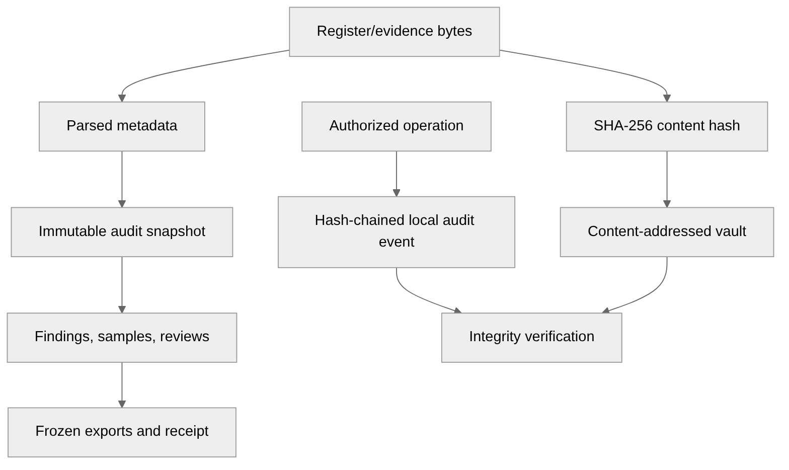</p>

<details><summary>Diagram source (Mermaid)</summary>

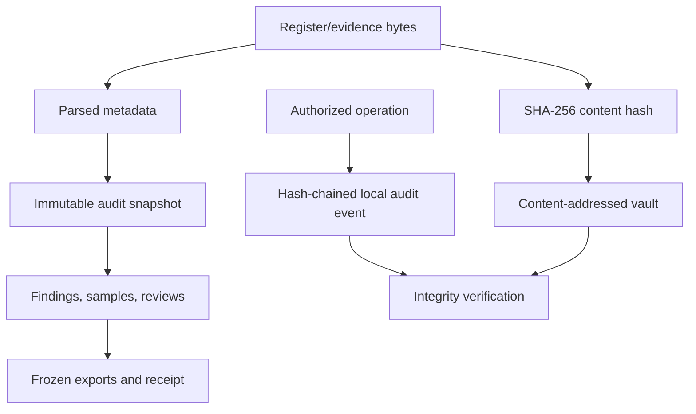

</details>

| Mechanism                | Provides                                                                 | Does not provide                                                                       |
| ------------------------ | ------------------------------------------------------------------------ | -------------------------------------------------------------------------------------- |
| SHA-256 vault address    | Stable content identity and source-change detection.                     | Authenticity, authorship, or independent delivery proof.                               |
| Immutable snapshot       | Reproducible sources, configuration, sampling, and rules.                | Continuous monitoring of later changes.                                                |
| Hash-chained audit log   | Local-chain verification and policy/security events.                     | External anchoring or protection against a file owner replacing DB and chain together. |
| Demo e-invoice signature | Real Ed25519 verification against configured test key.                   | Official NIC/IRP status or external validation.                                        |
| Post-test comparison     | Conservative mapping from later source/vault change to affected samples. | General lifecycle edit support or continuous audit.                                    |

Package creation rejects altered source bytes rather than silently substituting them. If an XLSX/XML export cannot safely represent source cells, JSON remains available and XLSX/ZIP export fails rather than truncating content.

## Authentication authorization and safeguards

Credentials resolve server-side to identity, role, expiry, and revocation status. Credential values are stored as hashes in a separate SQLite credentials database. The browser keeps credentials only in memory; refresh/sign-out clears the web session.

| Role/capability         | Permitted scope                                                                                                                                       |
| ----------------------- | ----------------------------------------------------------------------------------------------------------------------------------------------------- |
| client_employee         | Customers and sale lifecycles; register/disclosure upload; evidence-request response; permitted business changes.                                     |
| auditor                 | Reconciliation, runs, tests, samples/findings/lifecycle/integrity views, proposals, and package/export operations. Cannot write client business data. |
| Human-review capability | Separate trusted credential that appends a final review decision. It is capability separation, not human-presence attestation.                        |
| MCP caller              | Role-compatible discovery plus reauthentication and authorization on each action.                                                                     |

<p align="center">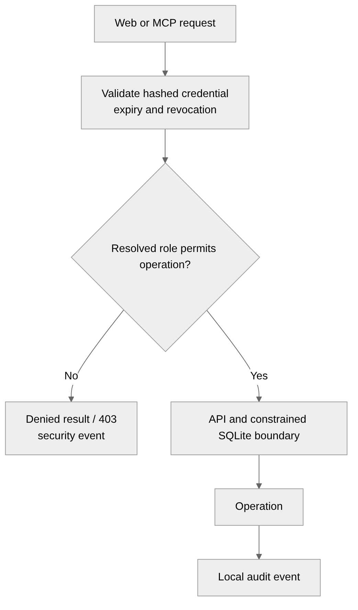</p>

<details><summary>Diagram source (Mermaid)</summary>

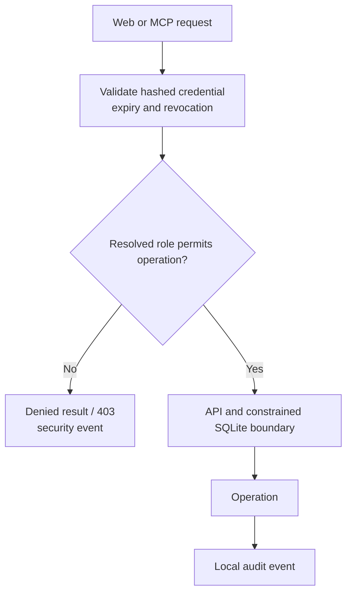

</details>

- The server never accepts a role from a form or MCP payload.
- UI visibility is not the authorization boundary: forbidden direct auditor writes return 403 and are logged.
- Posted journals reject update/delete; correction appends a reversing journal.
- MCP checks a fresh credential for discovery and invocation.
- MCP egress redacts GSTIN, PAN, financial-account, phone, and email values before a tool result is returned to an external agent. Policy can deny high-sensitivity categories; filtering is logged best-effort.
- Document text is returned under untrusted_document_content; instructions embedded in it must not be followed.
- Agent actions are approved one sealed proposal at a time; there is no standing "always allow" rule, so no approved command or credential is ever saved for reuse.
- Secrets stay out of the repository: `.env` and AI coding-tool folders (`.claude/`, `.cursor/`, `.gemini/`, `.specstory/`) are git-ignored, and the `Secret scan` workflow runs gitleaks over the full history (with extra rules for passwords typed inline in commands, which key-format scanners miss) and fails if any of those files is ever committed. Run it locally with `gitleaks git --config .gitleaks.toml .`.

SQLite authorizers are an application boundary, not database grants. PostgreSQL grants, tenant isolation, OS/process isolation, OAuth, production rate limiting, external anchoring, and file-owner protection are not demonstrated.

## MCP architecture and tools

Pramaan uses the official MCP Python SDK over stdio or local Streamable HTTP. The adapter does not open SQLite or load a separate dataset; it calls the authenticated FastAPI API.

<p align="center">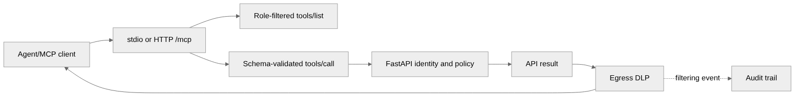</p>

<details><summary>Diagram source (Mermaid)</summary>

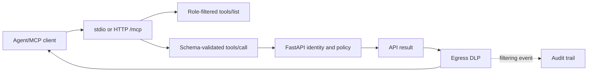

</details>

| Tool group              | Tools                                                                                                                                                                   |
| ----------------------- | ----------------------------------------------------------------------------------------------------------------------------------------------------------------------- |
| Client records          | create_customer, create_sale_lifecycle*, upload_sale*, update_business_record*                                                                                          |
| Client sources/evidence | upload_sales_register, upload_related_parties, respond_to_evidence_request                                                                                              |
| Audit execution         | create_audit_run, run_tests, reproduce_workpaper, import_register_to_workpaper, verify_audit_log                                                                        |
| Audit investigation     | get_findings, select_sales_tod, select_cutoff_tod, select_credit_note_tod, get_post_test_changes, get_sale_lifecycle, get_witnesses, trace_related_parties, get_journal |
| P1 compatibility        | create_sale_snapshot, run_sale_tests, get_sale_changes, export_workpaper                                                                                                |
| P5 review/exports       | create_export_package, export_p5_workpaper, export_memo, get_review_queue, propose_review_decision, get_p5_lifecycle                                                    |
| Shared                  | list_evidence_requests                                                                                                                                                  |

Schemas allow documented IDs and, where necessary, a payload; extra properties are rejected. List results support limit (default 20, maximum 100) and offset.

**Agent write policy (prototype).**
- `reverse_journal` is not an MCP tool. The reversal endpoint requires a 10–500 character reason, records the authenticated actor and reason in an immutable `p2_journal_reversals` row, and is denied server-side on the MCP channel even if called directly.
- Tools marked `*` create or edit the client's books and records. They are denied to agents by default and work only when the operator sets `PRAMAAN_MCP_BOOKS_WRITES=allow` (any other value denies). Every attempt, allowed or denied, is written to the audit log with its channel and tool name.
- There is no human-approval queue for agent writes yet; that is roadmap. The channel is declared by the MCP adapter in a request header, so this policy governs the adapter path. It does not stop someone who holds a client credential from calling the HTTP API directly, so do not issue client credentials to agents that should not write.
- Auditor-role identities have no tools that change client books or records; their only decision-related tool, `propose_review_decision`, records a proposal that a human reviewer must decide.

### Connect locally

With FastAPI running, use the tested stdio console:

```powershell
$env:PYTHONPATH = Join-Path $PWD.Path 'launcher'
$env:PRAMAAN_API_URL = 'http://127.0.0.1:8000'
$env:PRAMAAN_TOKEN = (.\.venv-p4\Scripts\python.exe -m Pramaan.backend.demo credentials --identity auditor)
.\.venv-p4\Scripts\python.exe -m Pramaan.backend.agent_console
```

For local Streamable HTTP:

```powershell
.\.venv-p4\Scripts\python.exe -m Pramaan.backend.mcp_server --http
```

Connect to http://127.0.0.1:8001/mcp with Authorization: Bearer followed by a fresh credential on every request, including discovery. This is loopback-only. Hosted ChatGPT, Claude, Gemini, and other third-party MCP-client compatibility is unverified; the supplied console is the tested fallback.

## AI/LLM integration

The audit engine, permissions, sampling, reconciliation, and final conclusions are not LLM decisions. [backend/agent_llm.py](backend/agent_llm.py) is an optional MCP client for OpenAI-compatible endpoints. It discovers the caller's permitted tools, converts schemas to function calls, and can only invoke available tools.

| AI use                                              | Guardrail                                                                                                                       |
| --------------------------------------------------- | ------------------------------------------------------------------------------------------------------------------------------- |
| Navigate permitted tools or summarize returned data | Role-filtered tool list, API authorization, schema validation, and egress DLP.                                                  |
| Draft narrative explanation                         | A deterministic validator keeps only sentences with valid resolved citations; otherwise a cited deterministic fallback is used. |
| Read document text                                  | Returned content is marked untrusted and sensitive identifiers are filtered.                                                    |

AI cannot change role, write client records as an auditor, finalize a human conclusion, invent amounts/findings/verdicts, or bypass egress policy. No successful live external-provider call is claimed by the integration verification; sending private audit data to a provider requires separate approval and deployment controls.

## Investigation agent

The investigation agent traces **one exception at a time** for the auditor: *goal → plan → act → check → re-plan*. It runs from the **Agent investigation** panel on any finding page, or through the `investigate_finding` MCP tool. Code: [backend/p6_agent.py](backend/p6_agent.py), [backend/party_match.py](backend/party_match.py), [web/src/investigate.tsx](web/src/investigate.tsx).

| Step | What happens | Who decides |
|---|---|---|
| Plan | The LLM picks the next check (or the labelled deterministic baseline runs a fixed policy when no key is set) | AI or fixed policy |
| Act | Tools read the frozen run snapshot, the sales register, recorded receipts, evidence and uploaded **bank statements** | Deterministic tools |
| Check | Bank credits are scored on amount, date, bill reference and a local fuzzy payer match ("Sharma Traders" ↔ "M/s Sharma Trdrs") | Deterministic tools |
| Conflict | Register vs invoice disagreement with no independent support, equal bank matches, or an uncertain payer: the server **stops** the run and shows both records | Server rule; the model cannot override |
| Act outward | The agent may only **propose** an evidence request. A human reviewer sees exactly what will be sent and to whom, then confirms or rejects; the payload must hash-match the proposal | Human |

Safeguards in code:
- **Amounts come only from tools.** Any amount in the model's summary that no tool returned (or the word "fraud") rejects the summary, and a system summary is shown instead.
- **Names stay on the server.** The model sees record IDs, amounts, dates, match bands and masked party references only, never names, GSTINs or bank narrations.
- **The agent can't wander.** It is scoped to the invoice under investigation.
- **Every step is recorded.** Each tool call is written to the hash-chained audit log, and each report is stored with its hash.
- **Only a human confirms.** There is no confirm tool for agents; the confirm and reject routes are human-only and blocked on the MCP channel.
- **Provider hiccups don't break a run.** Rate limits, HTTP 5xx and dropped connections are retried, then the next fallback model (`LLM_FALLBACK_MODELS`), then a backup provider (Groq when `GROQ_API_KEY` is set alongside Gemini). If every provider fails, an investigation restarts with the no-AI planner instead of stopping, and its report says so (`ai_fallback`). The same privacy filter applies whichever provider answers. The agent evaluation numbers were measured with Gemini; the report always names the provider and model that actually ran.

**Try it locally**
1. Generate a synthetic bank statement for your demo instance: `python -m Pramaan.backend.fixtures_agent --data .demo/runtime --out .demo/runtime/agent_fixtures`.
2. As the client, upload `bank_statement.csv` (Registers & disclosures → Source type: Bank statement). Optionally also upload `register_with_variance.csv`, reconcile it and rerun the audit.
3. As the auditor, open a finding and click **Investigate with AI**. Without an API key, click **Run without AI** for the deterministic baseline.

Or seed a ready-made instance with planted cases: `python -m Pramaan.backend.evaluate_agent --seed-instance .demo/agentx`, then start the API with `PRAMAAN_DATA=.demo/agentx`.

**Measured results** (`python -m Pramaan.backend.evaluate_agent --write-docs`; details in [docs/AGENT_EVAL.md](docs/AGENT_EVAL.md) and [docs/AGENT_EVAL-LLM.md](docs/AGENT_EVAL-LLM.md)) on 26 synthetic sale lifecycles with 26 planted cases:

| Metric | No-AI baseline planner | Gemini planner (`gemini-3.1-flash-lite-preview` + fallbacks) |
|---|---|---|
| Traced to a source record | 26/26 | 26/26 |
| Invented amounts | 0 | 0 |
| Correct outcome | 25/26 | 25/26 |
| Planted conflicts escalated | 5/6 | 5/6 |
| False escalations | 0 | 0 |
| Same outcome on 5 independent runs | 26/26 | 26/26 (2 of 130 investigations ended “unexplained” without drafting the evidence request; same outcome class) |

The AI planner matching the fixed baseline is the point: safety comes from the design (tools compute, server rules decide outcomes, humans confirm), not from trusting the model. Re-measure per model with `--planner llm --repeats 5 --write-docs`. Synthetic data only; no auditor time saving is claimed because no manual baseline has been timed.

## Outputs and user interface

| Artifact          | Contents                                                                                                                                                                                                                                                              |
| ----------------- | --------------------------------------------------------------------------------------------------------------------------------------------------------------------------------------------------------------------------------------------------------------------- |
| XLSX workpaper    | Contents sheet linking every sheet; register, sales/cut-off/credit-note workpapers, findings, summary, impact groups, import metadata, receipt, provenance, coverage, demonstration checks, and tickmarks. The register sheet retains original parsed cells without audit formulas/hashes/hidden columns. |
| PDF memo          | Frozen findings/reviews and reconciled summary data; plain-language check results; full hashes in a reproducibility appendix.                                                                                                                                                                                                                |
| Defensibility ZIP | Exact uploaded source bytes, workbook, memo, full report, evidence index, standards candidates, integrity verification, and receipt. Standards candidates require CA review.                                                                                          |
| JSON/API models   | Snapshot, package, lifecycle/evidence chips, audit events, and integrity results.                                                                                                                                                                                     |

Review outcomes are EXCEPTION_CONFIRMED, EXPLAINED, or DATA_ERROR; a final decision needs a reason and expected revision. Quantified impact additionally requires a nonnegative INR decimal, supporting evidence IDs, and an impact group. These are human assertions, not automated accounting verification or journal postings.

| Workspace      | Views                                                                                                 |
| -------------- | ----------------------------------------------------------------------------------------------------- |
| Client         | Business records; registers and disclosures; evidence inbox.                                          |
| Auditor        | Run summary; samples/evidence requests; findings/provenance; workpapers; integrity/post-test changes. |
| Human reviewer | Auditor views plus final-decision control when that credential carries human-review capability, including bulk review of selected findings (keyboard: `j`/`k` move, `x` select). |

**Help for first-time users.** The interface explains itself without hiding the audit detail:

- **Plain-language hints:** audit terms (observation, assertion, test of details, population, certainty item, snapshot, seed, potential misstatement and others) carry a small **?** that explains the word on hover, keyboard focus + Enter, or tap. One shared glossary ([web/src/glossary.tsx](web/src/glossary.tsx)) supplies every definition.
- **Help & guide** in the account menu (your avatar, top right): next steps for the signed-in role and the full glossary.
- **Getting started** card on each overview: 3–4 linked steps. It can be dismissed and restored from Help.
- **Next-step empty states:** empty tables say what to do (for example "No register uploaded yet. Upload your original sales register CSV above").
- **Readable labels:** activity events and coverage statuses are shown as sentences rather than codes; sample tabs read Sales sample / Year-end cut-off / Credit notes.

All of it is keyboard-accessible and checked with axe (0 violations on the core screens, including with a hint and the Help panel open) and at 360–1920 px without horizontal overflow.

See [docs/INTEGRATION_REVIEW.md](docs/INTEGRATION_REVIEW.md), [docs/design.md](docs/design.md), and [docs/website.md](docs/website.md) for tested integration and UI contracts.

## Installation configuration and tests

**Package import.** The code imports itself as `Pramaan.backend`. Put the tracked `launcher/` folder on `PYTHONPATH` (absolute path); its shim resolves to the repository root whatever the checkout folder is called, on Windows, macOS and Linux.

| Platform | Start the API and web UI |
| --- | --- |
| Windows | `START_PRAMAAN.bat` (or `start-local.ps1` for the API only) |
| macOS / Linux | `./run-local.sh` |
| Containers | `docker compose up --build`, then open http://127.0.0.1:8080 |

**Optional: OCR for scanned PDFs.** Install [Tesseract](https://github.com/tesseract-ocr/tesseract) on the machine running the API (Windows: the UB-Mannheim installer; macOS: `brew install tesseract`; Linux: `apt install tesseract-ocr`). PRAMAAN finds it on `PATH`, or set `PRAMAAN_TESSERACT` to the full path of `tesseract.exe`. `PRAMAAN_OCR=off` disables OCR. Without Tesseract everything else works, and scanned PDFs are refused with instructions. To check an installation end to end with synthetic scans, run `python -m Pramaan.backend.ocr_check` (12 checks: executable, version, English data, invoice and statement values, page references, quality labels, poor scans, time and page limits). The Docker image includes Tesseract (`--build-arg WITH_OCR=0` leaves it out); inside it, run `docker compose run --rm app python -m Pramaan.backend.ocr_check`.

**Credentials.** Issue and manage credentials with the security CLI against the same `PRAMAAN_DATA`:

```powershell
$env:PYTHONPATH = Join-Path $PWD.Path 'launcher'
$env:PRAMAAN_DATA = Join-Path $PWD.Path '.demo/runtime'
.\.venv-p4\Scripts\python.exe -m Pramaan.backend.security issue --subject me --role auditor --human-auditor --ttl 28800
.\.venv-p4\Scripts\python.exe -m Pramaan.backend.security issue --subject my-agent --role auditor --agent --ttl 900
.\.venv-p4\Scripts\python.exe -m Pramaan.backend.security list
.\.venv-p4\Scripts\python.exe -m Pramaan.backend.security revoke-subject --subject my-agent
```

- Default lifetime is 15 minutes; the maximum is 30 days (`--permanent` exists for trusted local development only).
- Human-review credentials expire within 7 days and can never be permanent or agent-bound.
- **Give AI agents only `--agent` credentials.** The server then applies the agent policy (no journal reversals, no books writes, no human review) from the credential itself, whatever headers the agent sends.

| Variable                    | Default               | Meaning                                                                                                         |
| --------------------------- | --------------------- | --------------------------------------------------------------------------------------------------------------- |
| PRAMAAN_DATA                | backend/data/         | Local storage root; use the same value for API, provisioning, MCP, and demo commands operating on one instance. |
| PYTHONPATH                  | unset                 | Absolute path of the repository's `launcher/` folder.                                                            |
| PRAMAAN_API_URL             | http://127.0.0.1:8000 | API address used by MCP tools. Loopback HTTP or HTTPS is accepted.                                              |
| PRAMAAN_TOKEN               | unset                 | Stdio MCP bearer credential (issue with `--agent`); do not persist it in source/configuration.                  |
| PRAMAAN_MCP_URL             | unset                 | Optional Streamable HTTP endpoint for the supplied console.                                                     |
| PRAMAAN_MCP_PORT            | 8001                  | Streamable HTTP MCP port.                                                                                       |
| PRAMAAN_MAX_UPLOAD_BYTES    | 10485760              | Maximum decoded upload (10 MiB). Request bodies above this as base64 JSON (+1 MiB) get HTTP 413 before parsing. |
| PRAMAAN_DEMO_IRP_PUBLIC_KEY | unset                 | Admin-configured test Ed25519 key for the demo IRP path; not an official integration.                           |
| PRAMAAN_E2E_INSTANCE        | browser               | Disposable browser-test data instance (reset automatically before each e2e run).                                |
| PRAMAAN_E2E_PYTHON          | auto-detected         | Python used by Playwright to reset the demo and start the API.                                                  |
| PRAMAAN_E2E_CHANNEL         | chrome                | Playwright browser channel; set to empty to use Playwright's bundled Chromium.                                  |
| PRAMAAN_E2E_VIDEO           | on                    | Set to `off` where Playwright's ffmpeg is not installed.                                                         |

**Tests.** CI (`.github/workflows/ci.yml`) runs all of these on every push and pull request; a separate `Secret scan` workflow checks the full history for leaked credentials. Current suite: 263 backend tests (9 of them need Tesseract and skip without it), 39 UI unit tests (and validated on two real Kaggle datasets: see docs/IMPORT_AUDIT.md), 8 browser journeys.

```powershell
$env:PYTHONPATH = Join-Path $PWD.Path 'launcher'
.\.venv-p4\Scripts\python.exe -m pip install -r backend/requirements-dev.txt
.\.venv-p4\Scripts\python.exe -m pytest backend/tests -q
.\.venv-p4\Scripts\python.exe -m Pramaan.backend.demo rehearse --name rehearsal
.\.venv-p4\Scripts\python.exe -m Pramaan.backend.release_verify --require-quality --output .demo/release-evidence.json
Push-Location web
npm run typecheck
npm test
npm run build
npx playwright install chromium ffmpeg
npm run test:e2e          # resets .demo/browser with fresh credentials, then starts both servers;
                          # includes keyboard-only journeys and a 360 px overflow check (e2e/journeys.spec.mjs)
# Optional UI audit capture (screenshots + axe), about 5 minutes:
# python e2e/ui-audit/seed_large.py, then UI_AUDIT_PHASE=after npx playwright test -c playwright.ui-audit.config.mjs
Pop-Location
```

Browser artifacts go to `web/test-results`; HTTP tracing is disabled, so artifacts never capture credential headers. The container setup (`compose.yaml`, `backend/Dockerfile`, `web/Dockerfile`) is for one company on one machine; see `docs/REMEDIATION.md` for hosted-deployment considerations.

**Behaviour notes (Nov 2026 remediation).**

- Sampling seeds are drawn by the server (`srv-` + 128 random bits) unless an auditor deliberately supplies one to re-perform a documented selection.
- Related-party records are parsed from the uploaded file (CSV or JSON) rather than taken from client JSON.
- Access decisions are kept in the append-only `access_log` table (`/ui/access-log`), not in the hash-chained business/audit event log.
- New snapshots reference register bytes in the vault by SHA-256; export packages embed them, so packages stay self-contained.
- Malformed dates are rejected at entry. Any legacy unreadable dates surface as INCONSISTENT findings instead of blocking the audit.

The release-evidence command records the synthetic evaluation, dataset manifest hash, ruleset/core implementation hashes, and its own manifest hash. It is a reproducibility receipt for the local prototype, not an external anchor, security certification, or independent audit review.

## Measured results and limitations

Regenerate the synthetic evaluation:

```powershell
$env:PYTHONPATH = Join-Path $PWD.Path 'launcher'
.\.venv-p4\Scripts\python.exe -m Pramaan.backend.evaluate
```

| Measure                                      | Result                                                                  | Meaning                                                     |
| -------------------------------------------- | ----------------------------------------------------------------------- | ----------------------------------------------------------- |
| Dataset                                      | Version 1.2; seed pramaan-eval-seed-2026-0001; 2025-04-01 to 2025-06-30 | Fictional synthetic test set.                               |
| Planted irregularities                       | 8                                                                       | Ground truth is read only by evaluator, never audit engine. |
| Pramaan recall                               | 8/8 (1.00)                                                              | Measured only on this test set.                             |
| Document-matching baseline                   | 3/8 (0.375)                                                             | Invoice/order/dispatch comparison baseline.                 |
| Hard-conflict false alarms on innocent sales | 0                                                                       | Does not measure real-world false-positive performance.     |
| Review-only innocent flags                   | INV-001 and INV-008                                                     | Threshold-pattern signals, not confirmed exceptions.        |

See [docs/EVALUATION.md](docs/EVALUATION.md) for class-by-class results and caveats. Two clean-reset technical rehearsals preserved originals, reproduced runs, detected randomized held-out differences, denied/logged auditor writes, and regenerated frozen artifacts. They were automated, not an independent-person blind exercise; evidence is in [backend/P6_REHEARSAL_RESULTS.json](backend/P6_REHEARSAL_RESULTS.json).

| Status                                              | Scope                                                                                                                                                                                                                                               |
| --------------------------------------------------- | --------------------------------------------------------------------------------------------------------------------------------------------------------------------------------------------------------------------------------------------------- |
| Implemented within documented prototype scope       | P1–P5: source preservation, lifecycles/reversals, reconciliation, supported deterministic rules, snapshots/sampling/evidence requests, credentialed API/MCP, DLP, human-gated review, frozen local packages.                                        |
| Technically demonstrated; final evidence incomplete | P6 UI integration and automated clean-reset rehearsals passed. The independent-person blind rehearsal is reported but lacks participant/scenario/artifact evidence, so overall P6 remains blocked.                                                  |
| Partial                                             | T03 needs contract/policy review; T12 lacks a complete independent-assertion workflow; T13 is demo-key verification; custom evidence requests, external notifications, general lifecycle editing, partner sign-off, and async jobs are unavailable. |
| Not demonstrated                                    | Live Tally/SAP/ERP connections and OCR of scanned PDFs (file imports only), official GST/IRP integration, external anchoring, production deployment, PostgreSQL grants, tenant/OS isolation, OAuth, production rate limits, hosted MCP interoperability, statistical projection, certification.                                 |

Read [docs/PROGRESS.md](docs/PROGRESS.md), [docs/PHASES.md](docs/PHASES.md), [docs/MASTER.md](docs/MASTER.md), [backend/P5_VERIFICATION_REPORT.md](backend/P5_VERIFICATION_REPORT.md), and [backend/P6_VERIFICATION_REPORT.md](backend/P6_VERIFICATION_REPORT.md) for gate evidence and limits.

## Repository map

| Path                              | Contents                                                                                     |
| --------------------------------- | -------------------------------------------------------------------------------------------- |
| [backend](backend/)               | FastAPI services, audit engine, security, MCP adapter, exports, tests, verification reports. |
| [web](web/)                       | React/Vite workspaces, UI tests, browser workflow.                                           |
| [data](data/)                     | Fictional synthetic fixtures and source manifest.                                            |
| [sample_uploads](sample_uploads/) | Synthetic register/evidence examples and test packs.                                         |
| [docs](docs/)                     | Documentation index: getting started, evaluations, design specs, reviews ([docs/README.md](docs/README.md)). |
| [docs/GETTING_STARTED.md](docs/GETTING_STARTED.md) | Non-technical start guide with screenshots.                                         |
| [docs/README-SYN.md](docs/README-SYN.md)    | Generator/checker specification, not a claim that every specified feature is implemented.    |
| [docs/DEMO.md](docs/DEMO.md)                | Accurate live walkthrough.                                                                   |
| [SECURITY.md](SECURITY.md) · [CONTRIBUTING.md](CONTRIBUTING.md) · [CHANGELOG.md](CHANGELOG.md) | Vulnerability reporting and protections; how to contribute; change history. |

## Running it for real: accounts, encryption, backups

On Windows (PowerShell; drop the `.\` in Command Prompt), `START_PRAMAAN.bat` runs these admin tools against the app's own data folder (`.demo\runtime` unless `PRAMAAN_DATA` is set):

```powershell
# 1. Vault key, stored OUTSIDE the data folder (back it up separately)
.\START_PRAMAAN.bat vault new-key C:\pramaan-keys\vault.key
$env:PRAMAAN_VAULT_KEY_FILE = "C:\pramaan-keys\vault.key"
.\START_PRAMAAN.bat vault encrypt

# 2. Named accounts with an authenticator app (password asked interactively)
.\START_PRAMAAN.bat accounts add username --role auditor
#    replace 'username' with the name you want; use --role client_employee for a client login, add --human for final sign-off rights
.\START_PRAMAAN.bat accounts list
#    also: unlock NAME, reset-mfa NAME, set-password NAME, disable NAME, enable NAME

# 3. Encrypted backup, verify, restore (passphrase asked interactively, 12+ characters)
.\START_PRAMAAN.bat backup create --out D:\pramaan-backups --keep 14
.\START_PRAMAAN.bat backup verify D:\pramaan-backups\pramaan-backup-<time>.pramaan
.\START_PRAMAAN.bat backup restore <file> --to .\restored-data
```

Encrypted evidence needs the key when the app runs too, so make the setting permanent with `setx PRAMAAN_VAULT_KEY_FILE C:\pramaan-keys\vault.key` (then open a new window). Without it the app reports "Evidence vault locked" rather than serving files.

On macOS/Linux use `PYTHONPATH=launcher PRAMAAN_DATA=.demo/runtime python -m Pramaan.backend.<accounts|backup|vault_tools> ...`.

Once an account exists, the sign-in page opens on **Account**; launcher credentials still work under **Credential**. The SQLite databases are not encrypted by PRAMAAN: keep the data folder on an encrypted disk (BitLocker / FileVault).

## Security, contributing and changes

- [SECURITY.md](SECURITY.md): how to report a vulnerability privately, what is protected, and known limits.
- [CONTRIBUTING.md](CONTRIBUTING.md): ground rules (no mock implementations, no weakened safeguards, reversible data changes), setup, checks and commit style.
- [CHANGELOG.md](CHANGELOG.md): notable changes by date.

## License

Copyright (C) 2026 the PRAMAAN contributors.

PRAMAAN is free software licensed under the [GNU Affero General Public License v3.0 only](LICENSE) (`AGPL-3.0-only`). You may use, study, modify and share it. If you distribute a modified version, or let others use a modified version over a network (for example as a hosted service), you must make your complete source code available to those users under the same license.

The synthetic data, fixtures and documentation in this repository are covered by the same license unless a file says otherwise. This is not legal advice.
