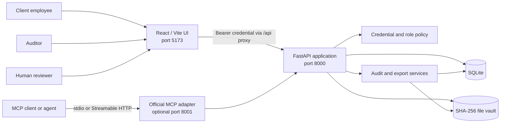
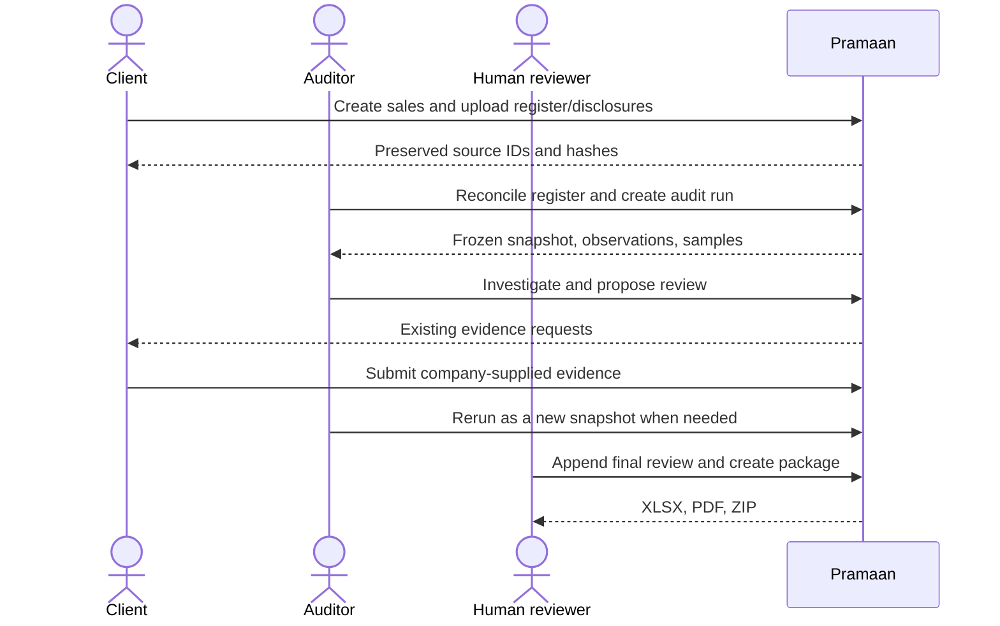
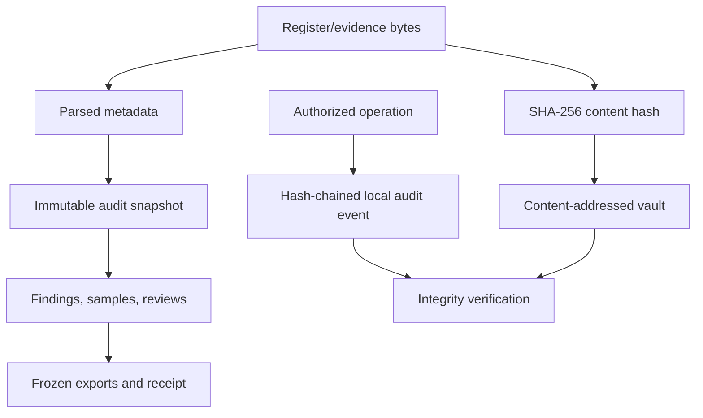
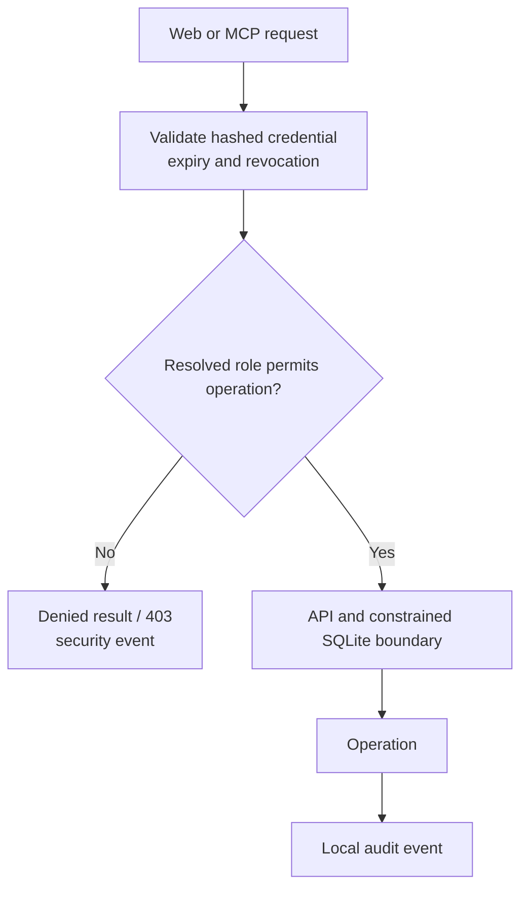
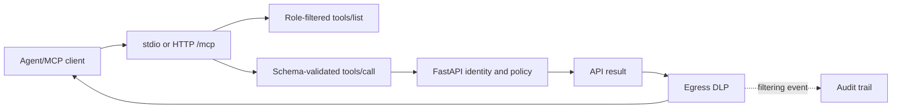

# Pramaan (प्रमाण)

Pramaan is a local, synthetic-data prototype for statutory revenue-audit work. It preserves a client-provided sales register, reconciles it with recorded sales, runs deterministic checks against an immutable snapshot, and produces reviewable workpapers.

An invoice can show a sale was recorded; it does not itself establish that the sale occurred. Pramaan preserves the original source, evidence and rules behind each observation, sampling provenance, later changes, and a separately authorized human conclusion.

> Scope: a single-company SQLite prototype using fictional synthetic data. It is not a production deployment, audit opinion, official GST/IRP verification, or fraud determination.

## Quick start

Prerequisites: Python 3.11+ (tested on 3.14), Node 20.19+ or 22.12+ (tested on Node 24.14.0), and npm. Run from this repository directory.

```powershell
py -m venv .venv-p4
.\.venv-p4\Scripts\python.exe -m pip install -r backend/requirements-dev.txt
$env:PYTHONPATH = (Split-Path -Parent $PWD.Path)
.\.venv-p4\Scripts\python.exe -m Pramaan.backend.demo reset
Push-Location web
npm ci
Pop-Location
```

Start the API:

```powershell
$env:PYTHONPATH = (Split-Path -Parent $PWD.Path)
$env:PRAMAAN_DATA = Join-Path $PWD.Path '.demo/runtime'
.\.venv-p4\Scripts\python.exe -m uvicorn Pramaan.backend.app:app --host 127.0.0.1 --port 8000 --no-access-log
```

Then start the web application in another terminal:

```powershell
Set-Location web
npm run dev
```

Open [http://127.0.0.1:5173](http://127.0.0.1:5173), then issue only the credential needed for the active session:

```powershell
$env:PYTHONPATH = (Split-Path -Parent $PWD.Path)
.\.venv-p4\Scripts\python.exe -m Pramaan.backend.demo credentials --identity client
.\.venv-p4\Scripts\python.exe -m Pramaan.backend.demo credentials --identity auditor
.\.venv-p4\Scripts\python.exe -m Pramaan.backend.demo credentials --identity human
```

reset reloads only .demo/runtime; it does not change source fixtures or backend/data. It creates synthetic business data, revocable credentials, preserved sources, reconciliation data, and a sample audit run. Do not reset an instance whose work must be retained.

## Demonstration

No product screenshots or video are tracked in this repository, so this README intentionally does not invent media links. The repeatable browser walkthrough is [web/e2e/workflow.spec.mjs](web/e2e/workflow.spec.mjs); accurate narrated steps are in [DEMO.md](DEMO.md).

1. A client creates business records and preserves an original register upload.
2. An auditor reconciles the register and opens an immutable audit run.
3. The auditor investigates samples, findings, evidence requests, and integrity status.
4. A client submits company-supplied evidence; a rerun creates a new snapshot rather than changing history.
5. An auditor stores a proposal; a separately provisioned human reviewer appends the final decision and creates frozen exports.
6. A later source revision is preserved as a new upload and appears as a post-test change without rewriting earlier packages.

## Contents

- [What is built](#what-is-built)
- [System architecture](#system-architecture)
- [End-to-end workflow](#end-to-end-workflow)
- [Audit engine and detection rules](#audit-engine-and-detection-rules)
- [Evidence integrity and cryptography](#evidence-integrity-and-cryptography)
- [Authentication authorization and safeguards](#authentication-authorization-and-safeguards)
- [MCP architecture and tools](#mcp-architecture-and-tools)
- [AI/LLM integration](#aillm-integration)
- [Outputs and user interface](#outputs-and-user-interface)
- [Installation configuration and tests](#installation-configuration-and-tests)
- [Measured results and limitations](#measured-results-and-limitations)

## What is built

| Area              | Actual implementation                                                                                                                                                                                                       |
| ----------------- | --------------------------------------------------------------------------------------------------------------------------------------------------------------------------------------------------------------------------- |
| Business records  | Client employees create customers and atomic sale lifecycles: order, dispatch, invoice, a balanced receivable/revenue/tax journal, plus optional receipt, credit note, and invoice evidence. Corrections append a reversal. |
| Preserved sources | CSV registers and related-party disclosures are stored by SHA-256-addressed content. Parsed comparison metadata is kept separately from original bytes.                                                                     |
| Audit runs        | Auditor-created immutable snapshots retain period, source state, rule/sampler versions, sampling seed, and snapshot hash. Reruns are new runs.                                                                              |
| Audit work        | Reconciliation, related-party leads, deterministic tests, reproducible sampling, evidence requests, post-test-change mapping, and audit-log verification.                                                                   |
| Review            | An auditor can propose a decision. A separately provisioned human-review credential appends the final decision and any supported impact assertion.                                                                          |
| Exports           | Frozen XLSX workpapers, PDF memo, and defensibility ZIP bind the stored snapshot, sources, reviews, rules, and integrity data.                                                                                              |
| Interfaces        | React/Vite client and auditor workspaces plus an official MCP SDK adapter over the implemented backend.                                                                                                                     |

## System architecture



| Component             | Location                                                                                       | Responsibility                                                                                                       |
| --------------------- | ---------------------------------------------------------------------------------------------- | -------------------------------------------------------------------------------------------------------------------- |
| Web application       | [web](web/)                                                                                    | Client records, preserved sources, audit runs, findings, workpapers, and integrity views. No direct database access. |
| API/policy boundary   | [backend/app.py](backend/app.py)                                                               | Authenticated FastAPI routes, policy checks, domain orchestration, and UI read models.                               |
| Domain/audit services | [backend/p2.py](backend/p2.py), [backend/p3.py](backend/p3.py), [backend/p5.py](backend/p5.py) | Lifecycle/reconciliation, snapshot tests and sampling, then review/package generation.                               |
| Security/trail        | [backend/security.py](backend/security.py), [backend/p4.py](backend/p4.py)                     | Hashed credential storage, expiry/revocation, constrained SQLite connections, and local audit events.                |
| MCP adapter           | [backend/mcp_server.py](backend/mcp_server.py)                                                 | Official SDK adapter with no direct DB/domain imports; it delegates each tool call to FastAPI.                       |
| Content vault         | selected data root                                                                             | SHA-256-addressed bytes for source files and evidence.                                                               |

| Design rule            | Meaning                                                                                                                |
| ---------------------- | ---------------------------------------------------------------------------------------------------------------------- |
| Preserve originals     | A revised register is a new upload, never an overwrite.                                                                |
| Deterministic core     | Audit observations, snapshots, reconciliation, and sampling do not depend on an LLM.                                   |
| Separate authorities   | Client writes, auditor investigation, auditor proposals, and final review are separate operations.                     |
| Frozen outputs         | Packages are created from stored snapshot/review data; live changes require a new package.                             |
| Honest integrity claim | Hashes establish content identity and local-chain tampering signals, not source authenticity or file-owner resistance. |

## End-to-end workflow



| Step              | Persisted result                                                               | Boundary                                                                          |
| ----------------- | ------------------------------------------------------------------------------ | --------------------------------------------------------------------------------- |
| Preserve register | Original CSV bytes, source hash, parsed rows, import metadata                  | Comparison metadata cannot alter source bytes.                                    |
| Reconcile         | T00 register-only/system-only, field-difference, and parse-review observations | Invalid/missing comparison input is a review gap, not an established discrepancy. |
| Create run        | Snapshot, hash, period, seed, versions, coverage, findings, samples            | A rerun is a new immutable run.                                                   |
| Evidence          | Persisted requests and company-supplied evidence references                    | The request-listing tool exposes requests; it does not send external messages.    |
| Review/package    | Revisioned proposal/final decision and stored exports                          | Existing packages remain frozen after live changes.                               |

## Audit engine and detection rules

Audit rules operate on saved audit-run data. Their output is a deterministic observation for review, not an automatic fraud conclusion. The synthetic pack is documented in [data/README.md](data/README.md).

| Test    | Current implementation                                                                                                                       | Result framing                                                                                                                                   |
| ------- | -------------------------------------------------------------------------------------------------------------------------------------------- | ------------------------------------------------------------------------------------------------------------------------------------------------ |
| T00     | Register reconciliation using field-aware calendar-date and exact-cents comparison; preserves raw values and reports differences/parse gaps. | A discrepancy or review gap.                                                                                                                     |
| T01     | Dated disclosed related-party classification.                                                                                                | Classification input, not fraud.                                                                                                                 |
| T02     | Candidate relationship edges and elementary directed-cycle detection in the synthetic counterparty graph.                                    | Pattern requiring corroboration.                                                                                                                 |
| T03/T04 | Cut-off/control-date and movement-evidence gaps.                                                                                             | A gap is not proof that a sale is false.                                                                                                         |
| T05     | Revenue journal without sale/invoice reference.                                                                                              | Book-record inconsistency for review.                                                                                                            |
| T06     | Invoice/dispatch value, quantity, and configured exact-field comparison.                                                                     | Deterministic inconsistency when inputs disagree.                                                                                                |
| T09/T10 | Post-period credit-note and threshold-pattern signals.                                                                                       | Review patterns; no inferred intent.                                                                                                             |
| T11     | Route/time bounds, vehicle overlap, load estimate, event order, and PIN/consignee checks.                                                    | IMPOSSIBLE is reserved for a supported hard speed constraint with configured verified timestamp input; other conflicts stay review/inconsistent. |
| T12     | Assertion-specific evidence/provenance state.                                                                                                | Caller-supplied company evidence is not promoted to independent substantiation.                                                                  |
| T13     | Ed25519 signed demo e-invoice envelope check, field comparison, and acknowledgement timing.                                                  | Shipped path is DEMO_IRP_TEST_ONLY, never official registration verification.                                                                    |
| T15     | Supplied synthetic return versus books comparison.                                                                                           | Review/inconsistency, not a real tax filing error.                                                                                               |

Sampling uses a persisted hash-ranked seed and records selection reasons, population coverage, ruleset/sampler version, and workpaper-sheet assignment. Sales, cut-off, and credit-note sample sheets are supported. No statistical population-projection claim is made.

## Evidence integrity and cryptography



| Mechanism                | Provides                                                                 | Does not provide                                                                       |
| ------------------------ | ------------------------------------------------------------------------ | -------------------------------------------------------------------------------------- |
| SHA-256 vault address    | Stable content identity and source-change detection.                     | Authenticity, authorship, or independent delivery proof.                               |
| Immutable snapshot       | Reproducible sources, configuration, sampling, and rules.                | Continuous monitoring of later changes.                                                |
| Hash-chained audit log   | Local-chain verification and policy/security events.                     | External anchoring or protection against a file owner replacing DB and chain together. |
| Demo e-invoice signature | Real Ed25519 verification against configured test key.                   | Official NIC/IRP status or external validation.                                        |
| Post-test comparison     | Conservative mapping from later source/vault change to affected samples. | General lifecycle edit support or continuous audit.                                    |

Package creation rejects altered source bytes rather than silently substituting them. If an XLSX/XML export cannot safely represent source cells, JSON remains available and XLSX/ZIP export fails rather than truncating content.

## Authentication authorization and safeguards

Credentials resolve server-side to identity, role, expiry, and revocation status. Credential values are stored as hashes in a separate SQLite credentials database. The browser keeps credentials only in memory; refresh/sign-out clears the web session.

| Role/capability         | Permitted scope                                                                                                                                       |
| ----------------------- | ----------------------------------------------------------------------------------------------------------------------------------------------------- |
| client_employee         | Customers and sale lifecycles; register/disclosure upload; evidence-request response; permitted business changes.                                     |
| auditor                 | Reconciliation, runs, tests, samples/findings/lifecycle/integrity views, proposals, and package/export operations. Cannot write client business data. |
| Human-review capability | Separate trusted credential that appends a final review decision. It is capability separation, not human-presence attestation.                        |
| MCP caller              | Role-compatible discovery plus reauthentication and authorization on each action.                                                                     |



- The server never accepts a role from a form or MCP payload.
- UI visibility is not the authorization boundary: forbidden direct auditor writes return 403 and are logged.
- Posted journals reject update/delete; correction appends a reversing journal.
- MCP checks a fresh credential for discovery and invocation.
- MCP egress redacts GSTIN, PAN, financial-account, phone, and email values before a tool result is returned to an external agent. Policy can deny high-sensitivity categories; filtering is logged best-effort.
- Document text is returned under untrusted_document_content; instructions embedded in it must not be followed.

SQLite authorizers are an application boundary, not database grants. PostgreSQL grants, tenant isolation, OS/process isolation, OAuth, production rate limiting, external anchoring, and file-owner protection are not demonstrated.

## MCP architecture and tools

Pramaan uses the official MCP Python SDK over stdio or local Streamable HTTP. The adapter does not open SQLite or load a separate dataset; it calls the authenticated FastAPI API.



| Tool group              | Tools                                                                                                                                                                   |
| ----------------------- | ----------------------------------------------------------------------------------------------------------------------------------------------------------------------- |
| Client records          | create_customer, create_sale_lifecycle, upload_sale, update_business_record, reverse_journal                                                                            |
| Client sources/evidence | upload_sales_register, upload_related_parties, respond_to_evidence_request                                                                                              |
| Audit execution         | create_audit_run, run_tests, reproduce_workpaper, import_register_to_workpaper, verify_audit_log                                                                        |
| Audit investigation     | get_findings, select_sales_tod, select_cutoff_tod, select_credit_note_tod, get_post_test_changes, get_sale_lifecycle, get_witnesses, trace_related_parties, get_journal |
| P1 compatibility        | create_sale_snapshot, run_sale_tests, get_sale_changes, export_workpaper                                                                                                |
| P5 review/exports       | create_export_package, export_p5_workpaper, export_memo, get_review_queue, propose_review_decision, get_p5_lifecycle                                                    |
| Shared                  | list_evidence_requests                                                                                                                                                  |

Schemas allow documented IDs and, where necessary, a payload; extra properties are rejected. List results support limit (default 20, maximum 100) and offset.

### Connect locally

With FastAPI running, use the tested stdio console:

```powershell
$env:PYTHONPATH = (Split-Path -Parent $PWD.Path)
$env:PRAMAAN_API_URL = 'http://127.0.0.1:8000'
$env:PRAMAAN_TOKEN = (.\.venv-p4\Scripts\python.exe -m Pramaan.backend.demo credentials --identity auditor)
.\.venv-p4\Scripts\python.exe -m Pramaan.backend.agent_console
```

For local Streamable HTTP:

```powershell
.\.venv-p4\Scripts\python.exe -m Pramaan.backend.mcp_server --http
```

Connect to http://127.0.0.1:8001/mcp with Authorization: Bearer followed by a fresh credential on every request, including discovery. This is loopback-only. Hosted ChatGPT, Claude, Gemini, and other third-party MCP-client compatibility is unverified; the supplied console is the tested fallback.

## AI/LLM integration

The audit engine, permissions, sampling, reconciliation, and final conclusions are not LLM decisions. [backend/agent_llm.py](backend/agent_llm.py) is an optional MCP client for OpenAI-compatible endpoints. It discovers the caller's permitted tools, converts schemas to function calls, and can only invoke available tools.

| AI use                                              | Guardrail                                                                                                                       |
| --------------------------------------------------- | ------------------------------------------------------------------------------------------------------------------------------- |
| Navigate permitted tools or summarize returned data | Role-filtered tool list, API authorization, schema validation, and egress DLP.                                                  |
| Draft narrative explanation                         | A deterministic validator keeps only sentences with valid resolved citations; otherwise a cited deterministic fallback is used. |
| Read document text                                  | Returned content is marked untrusted and sensitive identifiers are filtered.                                                    |

AI cannot change role, write client records as an auditor, finalize a human conclusion, invent amounts/findings/verdicts, or bypass egress policy. No successful live external-provider call is claimed by the integration verification; sending private audit data to a provider requires separate approval and deployment controls.

## Outputs and user interface

| Artifact          | Contents                                                                                                                                                                                                                                                              |
| ----------------- | --------------------------------------------------------------------------------------------------------------------------------------------------------------------------------------------------------------------------------------------------------------------- |
| XLSX workpaper    | Register, sales/cut-off/credit-note workpapers, findings, summary, impact groups, import metadata, receipt, provenance, coverage, demonstration checks, and tickmarks. The register sheet retains original parsed cells without audit formulas/hashes/hidden columns. |
| PDF memo          | Frozen findings/reviews and reconciled summary data.                                                                                                                                                                                                                  |
| Defensibility ZIP | Exact uploaded source bytes, workbook, memo, full report, evidence index, standards candidates, integrity verification, and receipt. Standards candidates require CA review.                                                                                          |
| JSON/API models   | Snapshot, package, lifecycle/evidence chips, audit events, and integrity results.                                                                                                                                                                                     |

Review outcomes are EXCEPTION_CONFIRMED, EXPLAINED, or DATA_ERROR; a final decision needs a reason and expected revision. Quantified impact additionally requires a nonnegative INR decimal, supporting evidence IDs, and an impact group. These are human assertions, not automated accounting verification or journal postings.

| Workspace      | Views                                                                                                 |
| -------------- | ----------------------------------------------------------------------------------------------------- |
| Client         | Business records; registers and disclosures; evidence inbox.                                          |
| Auditor        | Run summary; samples/evidence requests; findings/provenance; workpapers; integrity/post-test changes. |
| Human reviewer | Auditor views plus final-decision control when that credential carries human-review capability.       |

See [INTEGRATION_REVIEW.md](INTEGRATION_REVIEW.md), [design.md](design.md), and [website.md](website.md) for tested integration and UI contracts.

## Installation configuration and tests

For a trusted local demo, a revocable permanent credential can be issued. Do not commit it or put it in a shared environment file.

```powershell
$env:PYTHONPATH = (Split-Path -Parent $PWD.Path)
$env:PRAMAAN_DATA = Join-Path $PWD.Path '.demo/runtime'
$clientToken = & .\.venv-p4\Scripts\python.exe -m Pramaan.backend.security issue --subject local-client --role client_employee --permanent
$auditorToken = & .\.venv-p4\Scripts\python.exe -m Pramaan.backend.security issue --subject local-auditor --role auditor --permanent
```

Revoke using python -m Pramaan.backend.security revoke with the same data root. Default credential lifetime is 15 minutes; maximum non-permanent lifetime is one hour.

| Variable                    | Default               | Meaning                                                                                                         |
| --------------------------- | --------------------- | --------------------------------------------------------------------------------------------------------------- |
| PRAMAAN_DATA                | backend/data/         | Local storage root; use the same value for API, provisioning, MCP, and demo commands operating on one instance. |
| PYTHONPATH                  | unset                 | Parent directory containing the Pramaan package.                                                                |
| PRAMAAN_API_URL             | http://127.0.0.1:8000 | API address used by MCP tools. Loopback HTTP or HTTPS is accepted.                                              |
| PRAMAAN_TOKEN               | unset                 | Stdio MCP bearer credential; do not persist it in source/configuration.                                         |
| PRAMAAN_MCP_URL             | unset                 | Optional Streamable HTTP endpoint for the supplied console.                                                     |
| PRAMAAN_MCP_PORT            | 8001                  | Streamable HTTP MCP port.                                                                                       |
| PRAMAAN_MAX_UPLOAD_BYTES    | 10485760              | Maximum decoded source or evidence upload accepted by local API routes (10 MiB default).                       |
| PRAMAAN_DEMO_IRP_PUBLIC_KEY | unset                 | Admin-configured test Ed25519 key for the demo IRP path; not an official integration.                           |
| PRAMAAN_E2E_INSTANCE        | browser               | Disposable browser-test data instance.                                                                          |

```powershell
$env:PYTHONPATH = (Split-Path -Parent $PWD.Path)
.\.venv-p4\Scripts\python.exe -m unittest discover -s backend/tests -v
.\.venv-p4\Scripts\python.exe -m compileall -q backend
.\.venv-p4\Scripts\python.exe -m Pramaan.backend.demo rehearse --name rehearsal
.\.venv-p4\Scripts\python.exe -m Pramaan.backend.release_verify --require-quality --output .demo/release-evidence.json
Push-Location web
npm run build
npm run typecheck
npm test
Pop-Location
```

Browser regression requires Chrome and Playwright ffmpeg. Stop manual servers on 8000/5173 first:

```powershell
.\.venv-p4\Scripts\python.exe -m Pramaan.backend.demo reset --name browser
Push-Location web
npx playwright install ffmpeg
npm run test:e2e
Pop-Location
```

Browser artifacts go to web/test-results; HTTP tracing is disabled so artifacts do not capture credential headers. No Docker Compose or production hosting setup is implemented.

The release-evidence command records the synthetic evaluation, dataset manifest hash, ruleset/core implementation hashes, and its own manifest hash. It is a reproducibility receipt for the local prototype, not an external anchor, security certification, or independent audit review.

## Measured results and limitations

Regenerate the synthetic evaluation:

```powershell
$env:PYTHONPATH = (Split-Path -Parent $PWD.Path)
.\.venv-p4\Scripts\python.exe -m Pramaan.backend.evaluate
```

| Measure                                      | Result                                                                  | Meaning                                                     |
| -------------------------------------------- | ----------------------------------------------------------------------- | ----------------------------------------------------------- |
| Dataset                                      | Version 1.2; seed pramaan-eval-seed-2026-0001; 2025-04-01 to 2025-06-30 | Fictional synthetic test set.                               |
| Planted irregularities                       | 8                                                                       | Ground truth is read only by evaluator, never audit engine. |
| Pramaan recall                               | 8/8 (1.00)                                                              | Measured only on this test set.                             |
| Document-matching baseline                   | 3/8 (0.375)                                                             | Invoice/order/dispatch comparison baseline.                 |
| Hard-conflict false alarms on innocent sales | 0                                                                       | Does not measure real-world false-positive performance.     |
| Review-only innocent flags                   | INV-001 and INV-008                                                     | Threshold-pattern signals, not confirmed exceptions.        |

See [EVALUATION.md](EVALUATION.md) for class-by-class results and caveats. Two clean-reset technical rehearsals preserved originals, reproduced runs, detected randomized held-out differences, denied/logged auditor writes, and regenerated frozen artifacts. They were automated, not an independent-person blind exercise; evidence is in [backend/P6_REHEARSAL_RESULTS.json](backend/P6_REHEARSAL_RESULTS.json).

| Status                                              | Scope                                                                                                                                                                                                                                               |
| --------------------------------------------------- | --------------------------------------------------------------------------------------------------------------------------------------------------------------------------------------------------------------------------------------------------- |
| Implemented within documented prototype scope       | P1–P5: source preservation, lifecycles/reversals, reconciliation, supported deterministic rules, snapshots/sampling/evidence requests, credentialed API/MCP, DLP, human-gated review, frozen local packages.                                        |
| Technically demonstrated; final evidence incomplete | P6 UI integration and automated clean-reset rehearsals passed. The independent-person blind rehearsal is reported but lacks participant/scenario/artifact evidence, so overall P6 remains blocked.                                                  |
| Partial                                             | T03 needs contract/policy review; T12 lacks a complete independent-assertion workflow; T13 is demo-key verification; custom evidence requests, external notifications, general lifecycle editing, partner sign-off, and async jobs are unavailable. |
| Not demonstrated                                    | Official GST/IRP integration, external anchoring, production deployment, PostgreSQL grants, tenant/OS isolation, OAuth, production rate limits, hosted MCP interoperability, statistical projection, certification.                                 |

Read [PROGRESS.md](PROGRESS.md), [PHASES.md](PHASES.md), [MASTER.md](MASTER.md), [backend/P5_VERIFICATION_REPORT.md](backend/P5_VERIFICATION_REPORT.md), and [backend/P6_VERIFICATION_REPORT.md](backend/P6_VERIFICATION_REPORT.md) for gate evidence and limits.

## Repository map

| Path                              | Contents                                                                                     |
| --------------------------------- | -------------------------------------------------------------------------------------------- |
| [backend](backend/)               | FastAPI services, audit engine, security, MCP adapter, exports, tests, verification reports. |
| [web](web/)                       | React/Vite workspaces, UI tests, browser workflow.                                           |
| [data](data/)                     | Fictional synthetic fixtures and source manifest.                                            |
| [sample_uploads](sample_uploads/) | Synthetic register/evidence examples and test packs.                                         |
| [README-SYN.md](README-SYN.md)    | Generator/checker specification, not a claim that every specified feature is implemented.    |
| [DEMO.md](DEMO.md)                | Accurate live walkthrough.                                                                   |
