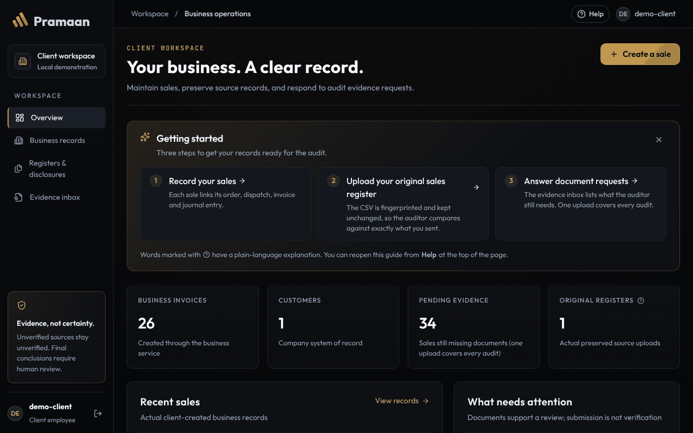
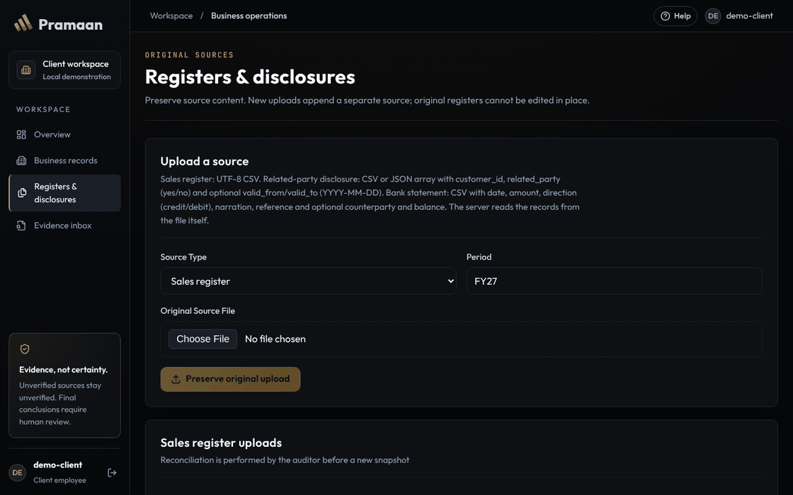
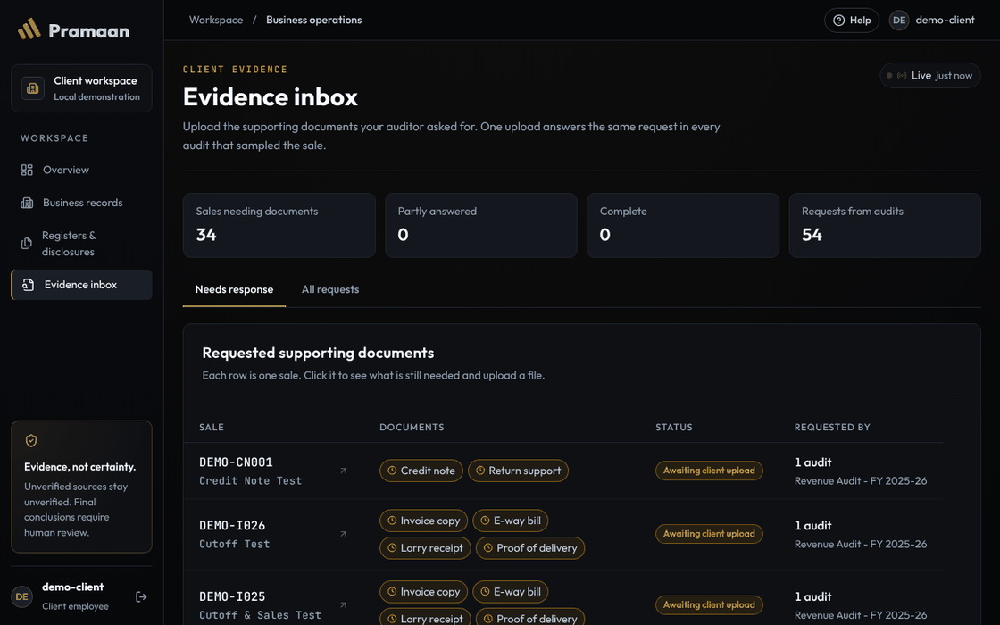
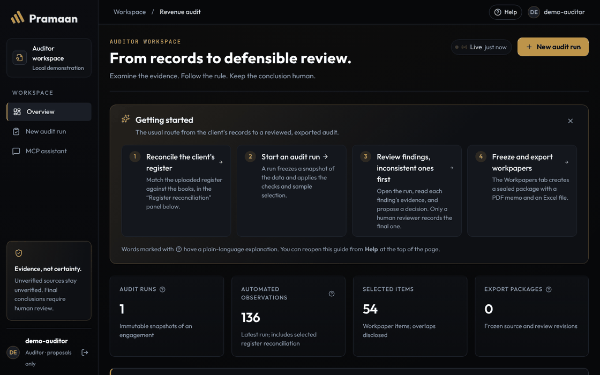
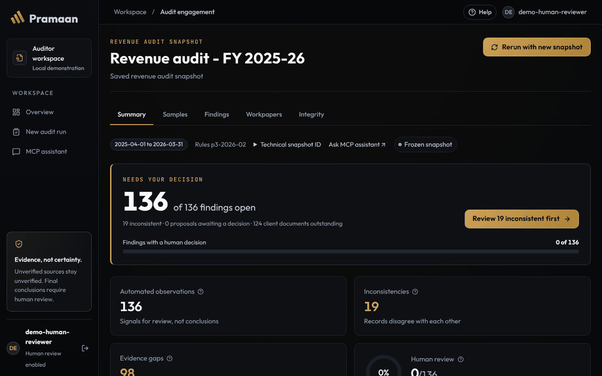
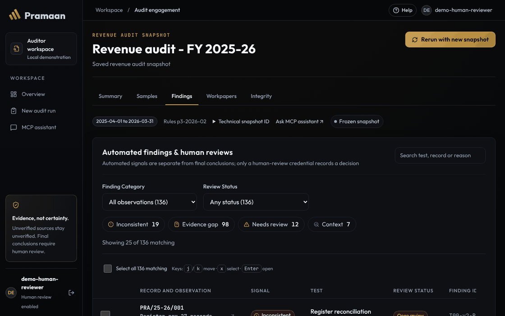
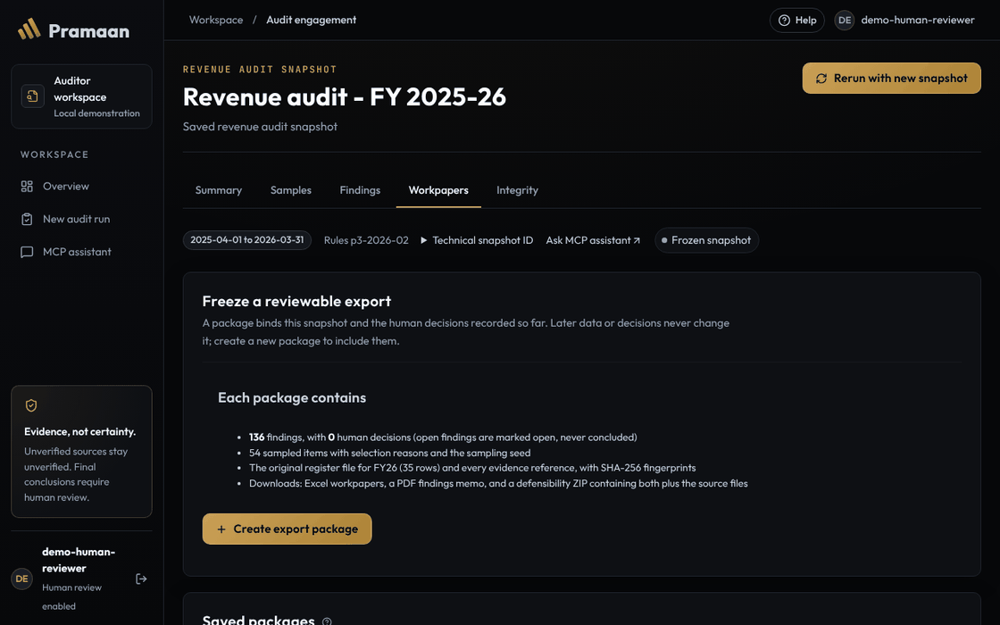
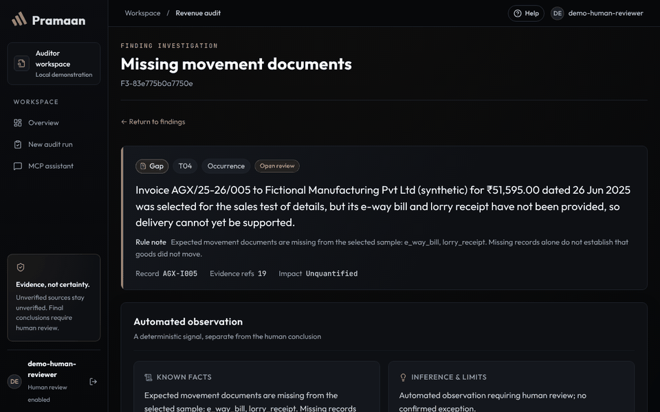

# Getting started with PRAMAAN

This guide is for people trying PRAMAAN for the first time, including people who are not developers or auditors. It runs on one computer with **synthetic (made-up) data**. Nothing is sent anywhere except, if you turn it on, the masked text the AI agent sends to its model provider.

## 1. Install two things (one time)

- **Python 3.11 or newer**: [python.org/downloads](https://www.python.org/downloads/). On Windows, tick “Add Python to PATH” during setup.
- **Node.js 20.19+ or 22.12+**: [nodejs.org](https://nodejs.org/).

## 2. Start it

**Windows:** double-click `START_PRAMAAN.bat` in the project folder.

**macOS / Linux:** in a terminal in the project folder, run `./run-local.sh`.

The first start takes a few minutes because it installs what it needs; later starts are quick. The launcher then:

- opens two windows, one for the API (port 8000) and one for the website (port 5173), which you leave open;
- opens the app in your browser at <http://127.0.0.1:5173>;
- opens a Notepad file, `.demo\runtime\LOCAL_DEMO_CREDENTIALS.txt`, with three sign-in keys. They expire after 8 hours.

## 3. Sign in

Paste one key from the Notepad file into **Access credential** and press **Enter workspace**.

| Key | Who it is for | What it can do |
|---|---|---|
| Client | The company being audited | Record sales, upload the sales register, answer document requests |
| Auditor | The audit team (or an AI agent) | Run checks, investigate, propose decisions |
| Human review | The responsible human reviewer | Everything the auditor can, plus record final decisions |

Each workspace opens with a short **Getting started** card. You can hide it and bring it back any time from **Help & guide** in the account menu (your avatar, top right). Words marked with a small **?** explain themselves when you hover over or tap them, and **Help** also has the full list of audit words in plain language.

## 4. The client side

**Overview.** What still needs attention, and every action recorded in your workspace.

**Registers & disclosures.** Upload the original sales register: a CSV, or the XML file Tally exports (*Export → Day Book*, XML format). A bank statement can be a CSV or the text PDF your net banking gives you. PRAMAAN fingerprints the file and keeps it exactly as sent; a new upload is stored as a new version, never an overwrite. After an upload you see how many rows were imported, skipped, rejected or need a look, with the reason for each. For a bank statement PRAMAAN also checks that the running balance adds up and that it carries on from your previous statement, and it won't accept the same statement file twice. Statements with one Amount column and a Dr/Cr marker work too. A scanned statement is read by OCR if Tesseract is installed on the computer running PRAMAAN; anything OCR is unsure of is listed for a person to check.

**Evidence inbox.** Each row is one sale the auditor wants documents for. Open it and upload the file; one upload answers that request for every audit. If you upload an invoice as a PDF, PRAMAAN shows what it read from it (invoice number, date, total) and whether taxable value plus tax equals the total. If the PDF prints two different values for the same thing, it says so instead of picking one. Uploaded the wrong file? Open it under *Files you have submitted* and choose *Replace it*: the corrected file becomes version 2, and the original is kept.

## 5. The auditor side

**Overview.** Reconcile the client's register, start an audit run, and see what needs a decision.

**An audit run.** A run freezes a snapshot of the data and runs every check. The summary starts with what needs your decision.

**Findings.** Automated signals, never conclusions. Open one to see its evidence, run the **agent investigation**, and propose a decision. Only the human-review key can record the final one.

**Workpapers.** Freeze a sealed export: a PDF memo, Excel workpapers, and a ZIP with the source files and their fingerprints.

## 6. The AI investigation agent (optional)

Without an AI key, **Run without AI** uses a fixed, rule-based planner and gives the same kind of result. To use Gemini or another OpenAI-compatible model, copy `.env.example` to `.env`, add your key, and restart. The AI only chooses which check to run next: code computes every amount, conflicts stop the run, and nothing is sent to the client until a human confirms it.

## 7. Start again with fresh demo data

Delete the `.demo\runtime` folder and start the launcher again. The launcher never overwrites existing data on its own.

## If something goes wrong

| Problem | Fix |
|---|---|
| `Failed to resolve import "@fontsource/..."` | Close the windows and start the launcher again; it reinstalls missing packages. |
| “Your session ended” | The key expired after 8 hours. Restart the launcher for new keys. |
| `No module named 'Pramaan'` when running a command yourself | Run `$env:PYTHONPATH = "$PWD\launcher"` first, from the project folder. |
| Port 8000 or 5173 already in use | Close the old PRAMAAN windows, or restart the computer. |

For developers, the [README](../README.md) covers configuration, the API, MCP and tests, and [CONTRIBUTING](../CONTRIBUTING.md) covers how to make changes.
